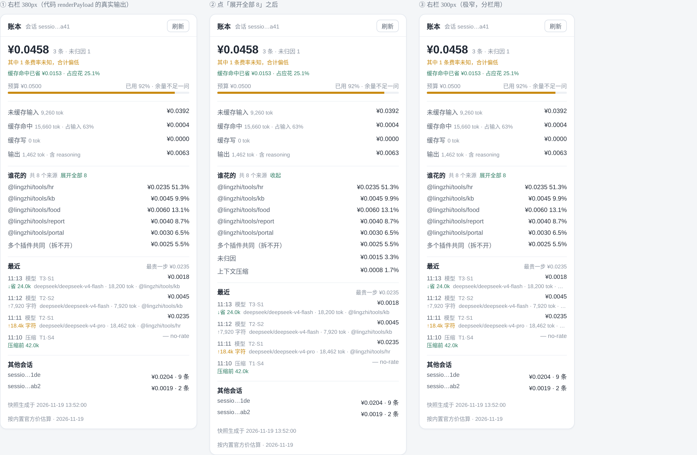

# @lingda/ledger

DSH 右侧栏的**会话成本仪表**（生态发布名 `dsh-plugin-ledger`，中文名「账本」）。

它回答三个问题，顺序很重要：

1. **这次会话花了多少**——四档分开算（未缓存输入 / 缓存命中 / 缓存写 / 输出），不给平均价。
2. **花在哪一步、为什么贵**——明细标出工具结果体量（`↑18.4k 字符`）、压缩前后上下文（`压缩前 42.0k`）、
   缓存命中省下的钱（`缓存命中已省 ¥0.0153 · 占应花 25.1%`）。
3. **还能问几次**——预算已用 92% · 还可约 5 次；余量不足时直接说"余量不足一问"。



> 图是 `lib/client.js` 的 `renderPayload()` 真实输出（三种宽度：380 / 380 展开 / 300px），
> 不是设计稿。刷新：`node scripts/render-panel.mjs`。

## 为什么不是"又一个 token 计费面板"

**缓存命中省下的钱是严格算出来的，不是估的。** 两个单价都在同一张价表里，
差额 `cacheReadTokens × (input − cacheRead)` 是确定值——这是账本里唯一能这样算的"省了多少钱"。
压缩省下的上下文只报 token 差、**不折算金额**，因为省下的 token 属命中还是未命中无法可靠推断，
硬乘单价就是编数字。

**未知永远显示成未知。** 费率缺失、用量不全、工具来源不明，一律显式返回原因（`— no-rate`、
`其中 1 条费率未知，合计偏低`），**绝不用 0 或估算值填坑**。一个敢说"我不知道"的账本，
才配被用来做决策。

## 三条铁律

1. **采集只订阅**：不改 session/event、不 emit、不在关键路径上做重活。
2. **决策只改配置**：只经 `agent/request` 返回替换的 `LlmCallConfig`，
   不在工具执行中途中断。
3. **未知即未知**：费率缺失、用量不全、工具来源不明，一律显式返回 unknown
   及原因，**绝不用 0 或估算值填坑**。

## 三条铁律

1. **采集只订阅**：不改 session/event、不 emit、不在关键路径上做重活。
2. **决策只改配置**：只经 `agent/request` 返回替换的 `LlmCallConfig`，
   不在工具执行中途中断。
3. **未知即未知**：费率缺失、用量不全、工具来源不明，一律显式返回 unknown
   及原因，**绝不用 0 或估算值填坑**。

## 架构

```
session/event (post-commit, fire-and-forget)
        │  根 ctx 订阅（agent scope 会被过滤，故不能挂 agent 内）
        ▼
   lib/ledger.js  ── 归一化 usage → 计价 → 归因 → 入账
        │                    │          │
        │              lib/pricing.js   lib/attribution.js
        ▼                    │          │
   lib/store.js  ◄───────────┴──────────┘
   （每会话双环 + 增量聚合 + LRU 会话淘汰）
        │
        ├──► lib/guard.js ──► agent/request（只改 LlmCallConfig，默认关）
        │                 └──► agent.inject（用 createUserMessage 自造事实，需配 budget.limit）
        └──► lib/audit-tool.js（ledger_query，Agent 主动查账，默认开）
                 └──► lib/client.js（M5：侧栏面板，只读快照）
```

## 对外接口

```js
// Host 半：插件通过 ctx.provide 暴露只读账本服务
ctx.ledger.snapshot(sessionId, { lastN })   // 冻结快照：totals / topSources(≤3) / recent / trace / generatedAt
ctx.ledger.sources(sessionId, { limit, sort }) // 全部来源（不截断）：amount / entries / share + 未知计数
ctx.ledger.overview({ limit })              // 跨会话概览，LRU 顺序（最近使用在前）
ctx.ledger.totals(sessionId)                // 只要累计
ctx.ledger.stats()                          // { handled, failures, sessions }
ctx.ledger.config                           // 生效配置（已合并默认值）

// 模型半：工具
ledger_query({ op?, sessionId?, lastN?, limit?, sort? })  // op=snapshot|sources|overview
```

`snapshot` 返回的对象是被冻结的，面板可以放心持有，不用担心被采集路径改写。

`sources` / `overview` 是纯读聚合：**不 touch LRU**——只读不续命，只有新事件才让会话提前，否则面板轮询会把 `maxSessions` 的淘汰策略废掉。

## 性能

`node --expose-gc scripts/bench.mjs`（本机 v22.23.4）：

| 场景 | 单事件成本 |
|---|---|
| 4 会话稳定态 | 1.21 µs |
| 64 会话稳定态 | 1.12 µs |
| 每条事件都换新会话（LRU 抖动，最坏） | 3.81 µs |
| 300k 事件后 heapUsed | 3.2 MB（有界） |

稳定态是微秒级、且与会话数无关；唯一会放大成本的是会话高频换入换出。


## 模块

| 文件 | 职责 | 关键点 |
|---|---|---|
| `lib/index.js` | 插件入口、事件接线、服务暴露 | `apply(ctx, config)`，纯 ESM |
| `lib/config.js` | 默认值与合并 | 改变行为的开关默认关闭 |
| `lib/usage.js` | TokenUsage 归一化 | 计数 disjoint，`totalTokens` 缺失不伪造 |
| `lib/pricing.js` | 四档单价计价 | 缓存读/写分价；无费率返回 unknown |
| `lib/ring.js` | 有界环形缓冲 | O(1) 写入，无 shift |
| `lib/store.js` | 会话账本与聚合 | 双环 + LRU + 已知/未知分离 |
| `lib/attribution.js` | 归因 | 仅 exact / shared / unresolved 三态 |
| `lib/ledger.js` | 采集 | 归因取 `step-1` 工具集（因果方向） |
| `lib/guard.js` | 预算守卫 | 双通道 + 回滞，只在跨阈值投递一次 |
| `lib/trace.js` | 行为流水 | OTel `gen_ai.*` 命名 + 默认脱敏 |
| `lib/audit-tool.js` | `ledger_query` | 返回摘要而非原始 JSONL |
| `lib/client.js` | 浏览器半 | M0 为空，保证可加载可卸载 |

## 配置示例

```yaml
ledger:
  capacity: 2000        # 每会话条目上限
  maxSessions: 64       # 会话 LRU 上限
pricing:
  currency: CNY
  rates:
    deepseek/chat:
      input: 0.000001
      output: 0.000002
      cacheRead: 0.0000002
      cacheWrite: 0.0000012
budget:
  limit: 5              # null = 不启用
  threshold: 0.8
  downgrade: null       # {provider, model, maxTokens}；显式配置才生效
attribution:
  toolOwners:
    food.query: plugin-food
    kb.search: plugin-kb
trace:
  enabled: false        # 隐私优先，默认关
  capacity: 5000
  maxTextLength: 200
```

## 已知边界（不要绕过）

- **工具级归因无法自动获得**：`tool/call` 无来源字段、`tools/change` 无载荷、
  `register` 签名不带来源。只能靠 `attribution.toolOwners` 声明。
  详见 `docs/spikes.md` P-2。
- **不能在 `agent/request` 里改上下文**：返回类型是 `LlmCallConfig`，
  源码注释明确 "cannot mutate messages"。
- **首版不写回会话日志**：`KNOWN_SESSION_EVENT_TYPES` 是固定集合，
  集合外事件会阻断持久化读取，除非带 `ignorable`。

## 开发

```bash
node --test test/*.test.mjs    # 38 例
npm run bench                  # 热路径基准（需 --expose-gc）
bash scripts/ci.sh             # 等价 CI：单测 + 性能门禁 + 契约冒烟
```

CI（`.github/workflows/ci.yml`）：Node 18/20/22 三档跑单测，仅 Node 22 跑性能门禁，
阈值只拦数量级劣化（稳定态 >6µs、会话抖动 >15µs、heap >32MB 才失败）。

`scripts/smoke-dsh.mjs` 用**真实** `@deepseek-ai/dsh-llm` 构造一次预算消息，
验证 `createUserMessage` 的契约；没装运行时时自动 SKIP 而不是失败。
这是唯一"必须真机才有意义"的检查，所以不放进单测。

`scripts/smoke-registry.mjs` 用**真实** `@deepseek-ai/dsh-tools` 的三个校验器
（`assertSupportedJsonSchema` / `assertObjectJsonSchema` / `validateJsonSchemaValue`）
验证工具定义，并真跑一次 `execute` 确认返回值能通过自己声明的 schema。

## 开发期挂载（不 install、不改 profile）

`mount/ledger-dev.overlay.yml` 是可直接叠加的 patch 层：

```bash
dsh --profile <已有profile> --patch <仓库>/mount/ledger-dev.overlay.yml
```

已实测：loader 会把 overlay 里的绝对路径规范化为 `file:///...` 再装配，
所以开发期不需要把插件装进 profile 的 `node_modules`。
先 `--dump-config` 看装配结果，确认 `lingda-ledger` 那一条在那里。


零构建、零运行时依赖：不 import 任何 `@deepseek-ai/*` 做业务逻辑；
唯一例外是预算事实要用的 `createUserMessage`，走可选 peer + 动态 import，
拿不到就自动降级为"只经 ledger_query 拉取"。

## 右侧栏面板

面板 = DSH 右侧栏的一个 tab（kind `ledger.cost`），数据来自 Host 写的**只读快照**：

```yaml
- id: lingda-ledger
  name: '@lingda/ledger'
  config:
    panel:
      enabled: true          # 默认关闭：写盘是外部副作用
      dir: .dsh/ledger       # 相对会话工作区根
      intervalMs: 3000       # 同会话最小落盘间隔
      maxBytes: 262144       # 超限降级为合计 + Top 来源
```

- 文件：`<session cwd>/.dsh/ledger/<safeSessionId>.json`，原子写（`.tmp` → rename）。
- 读取：浏览器侧 `workspaceFiles` remote，相对路径 `stat` 换绝对路径再 `read`。
- 打不开面板时先看 `ctx.ledger.panel`：`{enabled, dir, stats}`。

## 面板链路冒烟

```bash
node scripts/smoke-panel.mjs   # ci.sh 已接入
```

不 boot 真 DSH、不吃模型凭据：假 ctx 派发 `session/event` → 计价 → 落盘，
再用与生成声明同签名的 `workspaceFiles` remote 读回，断言两侧金额/四档/条目数逐项一致。
真机多出来的只有物理传输那一层。

## 费率从哪来（重要）

内置表只收**官方页面可查**的价格，不猜、不估：

| 模型 | 缓存命中 | 缓存未命中 | 输出 |
|---|---|---|---|
| `deepseek-v4-flash` | 0.02 | 1 | 2 |
| `deepseek-v4-pro` | 0.025 | 3 | 6 |
| `deepseek-chat` / `deepseek-reasoner` | 同 flash（官方明示的兼容别名） | | |

单位：元 / 百万 tokens。来源 `https://api-docs.deepseek.com/zh-cn/quick_start/pricing`，抓取日 2026-11-19。
官方已声明价格可能变动，别把这张表当合同。

三条口径说明：

- **`cacheWrite` 记 0**。DeepSeek 只有"命中 / 未命中"两档，没有独立的缓存写单价；缓存写入的
  token 本来就计入未命中输入。若这里再给价，同一批 token 会被收两次钱。其它 provider 单独
  收缓存写时，在配置里覆盖即可。
- **表里没有的模型** → `unknown(no-rate)`，面板显示 `—`，不用 0 或平均值冒充。
- **覆盖**按单模型深合并，只改你要改的那一项：

```yaml
pricing:
  rates:
    deepseek-v4-pro:
      output: 1.2e-6   # 元/token；等价于 1.2 元/百万
```

## 官方调价了怎么办：`pricing.json`

内置表是 2026-11-19 的价。官方一调价，你不需要改代码、也不需要等新版本：

```bash
# 写一份覆盖文件（不存在就纯用内置价）
mkdir -p ~/.dsh/ledger
cat > ~/.dsh/ledger/pricing.json <<'JSON'
{
  "asOf": "2026-12-01",
  "source": "https://api-docs.deepseek.com/zh-cn/quick_start/pricing",
  "rates": {
    "deepseek-v4-flash": { "input": 1.2, "output": 2.4, "cacheRead": 0.03, "cacheWrite": 0 }
  }
}
JSON
```

- **单位是元 / 百万 tokens**（和官方公告一致，不用自己换算成 1e-6）。
- **四档必须齐**（`input` / `output` / `cacheRead` / `cacheWrite`）。
- **整条生效或整条拒绝**，不逐档合并：四档共同定义一个模型的价格语义，缺一档就拿旧价补新价，
  算出来的数字既不是旧价也不是新价。宁可不认（显示 `—`），也不给一个看着像真的假数。
- 只覆盖你写到的模型，其余继续用内置价。
- 改完**重启会话**生效（boot 时读一次，计价热路径不做 IO）。

写错了不会静默回退：面板顶部会出现一条琥珀色警示说明"没生效、金额仍按内置价计算"，
`ledger_query` 带 `op: "rates"` 可以查当前生效表、来源日期、以及哪个模型因为什么被忽略。

## 面板预览（代码的真实输出）

```bash
node scripts/render-panel.mjs   # → docs/panel-preview.html
```

不是设计稿：它调用 `lib/client.js` 的 `renderPayload()`，用与测试同一份 payload
生成真实 DOM，380px / 300px 两档并排。改 UI 后重跑即可刷新。

## 来源桶口径

面板与 `ledger_query` 的 `sources` 里，三个保留 key 各有确定含义：

| key | 含义 |
|---|---|
| `shared:unknown` | 多个**已知** owner 共同贡献上下文，确实拆不到单个插件 |
| `unattributed` | 完全没有归因信号（无 owner、无映射）——不是"拆不开"，是"没来源" |
| `system:compaction` | 上下文压缩产生的调用，不属于任何插件 |

面板会把这几个 key 翻成人话再显示，不把原始字符串露给用户。

## 发布前检查

```bash
bash scripts/prepublish.sh
```

闸门依次检查：工作区干净 → 分支 main → `scripts/ci.sh` 全通过 → `npm pack` 内容只有
`package.json` / `README.md` / `cordis.patch.yml` / `lib/` → 打印版本与 `private` 状态。

两点由 owner 决定，代码不代劳：
- `private` 目前是 `true`，真要发 registry 需改成 `false` 并确认目标 registry；
- 仓库尚未配置 `git remote`（推到哪个组织需要明确地址）。
- `license` 未声明——开源/商业由产品决策定，脚本只如实打印。

**不加 slots 到 `dsh.client.inject` 的原因**：`inject` 是"必需服务"，写进去以后
没有 slots 的宿主（CLI 形态）会直接不启动插件，连 tab 类型都注册不上。
现在的写法是可选访问：有 `ctx.slots` 就挂正文，没有就只登记类型——降级更稳。

## 里程碑

- M0 骨架 + 计价/归因/存储/守卫/工具 + 探针报告 ✅
- M1 契约核实 + 装配集成测试 + 热路径基准 ✅（4 处猜测全部落定，见 `docs/spikes.md`）
- M2 `ledger_query` / `ctx.ledger` 真机接入 DSH 进程
- M3 行为流水落盘 ✅（`lib/trace-file.js`：入队 + 合并写 + 单文件封口，双击开关默认关）
  - 面板快照落盘 `lib/snapshot-file.js`（原子写 + 节流 + 超限截断，默认关闭）
- M4 面板只读快照 + 成本 Top
- M5 侧栏「账本」Tab 与设置卡片
  - 已落地 P0：`ledger.cost` 类型登记 + 引导页入口（空白右栏可见「账本」胶囊）+ 关闭清理；
    正文（`sidebar.right.pane.tab`）待 `dsh-client-ui-slots` 契约核实后接入，见 `docs/spikes.md` 末节。


### 不装 key 也能验证整条链路

```bash
bash scripts/ci.sh --real-host        # 门禁全跑，含真机端到端（需 DSH_ROOT）
node scripts/verify-real-host.mjs --cwd /path/to/dsh-root   # 只跑真机那一段
```

宿主 provider 的端点可配（`$DEEPSEEK_BASE_URL`），所以脚本能在**没有任何真实凭据**的机器上：
起一个本地 Messages 兼容端点（返回固定 usage）→ 让 DSH 真发一次请求 → 读账本快照 → 逐项核对金额、
四档拆分、缓存节省、路由、时间格式。7 项断言，全部可复现。

**它证明什么、不证明什么**（这点必须说清楚）：

| 证明 | 不证明 |
|---|---|
| 事件真的收到、形状解析对 | 模型跑得好不好 |
| 计价公式与手算一致 | 真实 token 分布下的表现 |
| 快照真的落盘、字段类型对 | 右栏 UI 在浏览器里的呈现（需人看） |
| 面板读得到、金额不自适应吞 0 | — |

模型是固定文本、token 是脚本给的固定值，所以它是**链路证据**，不是效果证据。

## 安装（DSH 侧外部插件）

```bash
# 代码仓（已公开，可直接 clone/链接）
git clone https://gitee.com/linzhengtong/dsh-plugin-ledger.git

# npm 尚未发布（见"已知限制"），发布后这一行才可用
dsh plugin add @lingda/ledger
```

> **用 `file:` 装开发版时有个坑（我们踩过）**：pnpm 把文件**硬链接**进 profile ——
> 改已有文件的内容会即时生效（同 inode），但**新增文件不会被同步**（目录结构是复制的）。
> 所以往里加了新模块之后，必须重装才能看到它：
>
> ```bash
> rm -rf ~/.dsh/profiles/<name>/node_modules/@lingda
> dsh plugin --profile <name> add file:/path/to/dsh-plugin-ledger
> ```
>
> 症状很好认：宿主启动时告警 `lingda-ledger (@lingda/ledger): failed to import`。

```jsonc
// workspace 配置：面板默认关，需要显式打开（写盘是外部副作用，不该由观测默认产生）
{
  "panel": { "enabled": true, "dir": ".dsh/ledger" },
  "budget": { "limit": 0.05, "threshold": 0.8 }
}
```

右侧栏会出现「账本」标签页。三个开关默认全关，理由写在 `lib/config.js` 顶部注释里：

| 开关 | 默认 | 为什么要显式开 |
|---|---|---|
| `panel.enabled` | `false` | 落盘是外部副作用 |
| `trace.enabled` | `false` | 隐私优先：行为流水默认不记 |
| `trace.file.enabled` | `false` | 写文件是二次副作用，要再开一层 |

## 免费与商业的边界

**这个插件本身是免费的，全部功能都在开源版里。** 商业化不靠给插件加锁，靠后面那层：

| 层 | 归属 | 回答的问题 |
|---|---|---|
| 单会话账本（本仓库） | 开源免费 | 这次会话贵不贵、贵在哪一步 |
| 团队账本（未开工） | 付费 | 这个部门/项目/人这周花了多少、该不该管 |
| 企业账本（未开工） | License + 私有化 | 采集到的钱和账单对得上吗、合规审计 |

分界线是「会话账本 → 团队账本」，不是更多图表。要跨人/跨工具聚合，必须先有身份绑定、
上报通道、共享计价包三块底座——这些还没做，也不打算在验证之前做。

## 已知限制

- **归因只到插件级，且只认同轮上一步**：工具来源靠 `attribution.toolOwners` 映射，
  跨轮不继承（宿主不提供工具归属信息，见 `docs/spikes.md` C-5）。
- **压缩省下的上下文不折算金额**：只报 token 差，理由见上。
- **内置价表的日期是 `2026-11-19`**：厂商调价后需人工更新 `lib/pricing-table.js`，
  面板脚注会显示这个日期，不会假装"实时"。
- **npm 尚未发布**：代码仓已公开（`gitee.com/linzhengtong/dsh-plugin-ledger`，Apache-2.0），
  但 `private: true` 保留、npm 未认证，所以现在还不能 `npm install`。

## 开发

```bash
node --test test/*.test.mjs                 # 158 例断言
node --expose-gc scripts/bench.mjs --gate   # 性能门禁（热路径 <6µs、长会话 <8µs/<20MB）
bash scripts/ci.sh                          # 单测 + 基准 + 三个冒烟
node scripts/render-panel.mjs               # 刷新 docs/panel-preview.html
```

协议与身份字段见 [`docs/wire-format.md`](docs/wire-format.md)——那里冻结的是**不可逆**的部分
（计量单位、幂等键、身份线索），已经在采集时写入，哪怕现在一条都不上报。
